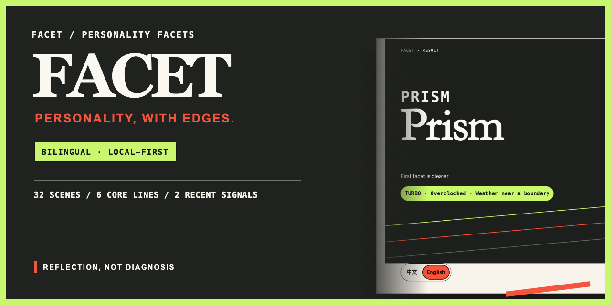
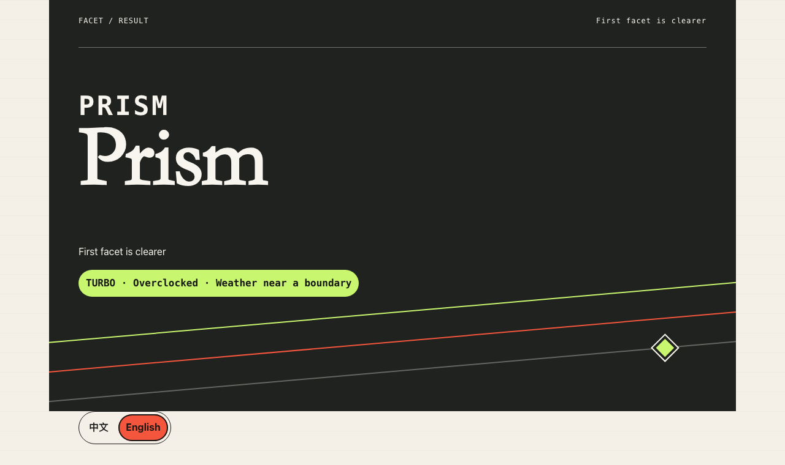

# FACET · Personality Facets

[中文说明](README.zh-CN.md)



FACET is a bilingual, local-first personality reflection quiz built from 32 everyday scenarios. It maps six core tendencies and two recent-state signals without pretending to diagnose you, or crown a rarest type.

**Live demo:** [thworry.github.io/facet-personality](https://thworry.github.io/facet-personality/)



## What it does

FACET asks what you usually do, then briefly checks how the past two weeks have felt. The result includes:

- six continuous core lines: inner compass, starting rhythm, planning style, social recharge, boundary strength, and expression strategy;
- two recent signals for load and recovery flexibility;
- a nearest archetype, an adjacent facet, and one of four current-weather descriptions;
- practical notes, local history for up to three results, and a share card generated in your browser.

There are 12 archetypes, but no velvet rope around any of them. They are reference points on continuous dimensions, not ranks, rarities, or permanent identities.

Changing the language changes presentation only. The Chinese and English versions share the same question IDs, scoring directions, thresholds, and archetype centers. That consistency does not establish cross-cultural psychometric equivalence.

## Privacy and boundaries

The quiz runs entirely in your browser. FACET has no account system, analytics script, ad tracker, or answer upload. Unfinished progress, language preference, and up to three results stay in local storage until you clear them. Share cards are drawn with Canvas and downloaded locally.

FACET is for entertainment and self-reflection. It is not a peer-reviewed psychological scale and should not be used for diagnosis, hiring, career decisions, or verdicts about a relationship.

## Feedback and privacy

Taking the quiz sends nothing to GitHub or the maintainer. The project has no analytics, tracking pixel, account, or remote answer upload.

Opening a GitHub issue is optional and public. Please describe bugs with synthetic examples, and do not include your answer set, result history, localStorage dump, tokens, or unrelated personal data. Report suspected vulnerabilities through the [private security advisory form](https://github.com/Thworry/facet-personality/security/advisories/new); see [SECURITY.md](SECURITY.md) for the full policy.

## How scoring works

Each answer uses a five-point scale. Reverse-keyed questions are flipped before each dimension's four answers are averaged and mapped to 0 to 100. Neither end of a dimension is better.

The six core scores are compared with 12 fixed archetype centers using normalized Euclidean distance. The two nearest centers become the primary and adjacent references. Separate, explicit thresholds determine result clarity, the standout line, and the recent-weather label. The scoring metadata is language-neutral and covered by tests in `tests/scoring.test.ts` and `tests/result.test.ts`.

## Development

Requirements: Node.js 24 or newer and pnpm 11.19.0.

```bash
pnpm install --frozen-lockfile
pnpm dev
pnpm lint
pnpm typecheck
pnpm test
pnpm test:e2e
pnpm build
```

`pnpm dev` starts the local Vite server. `pnpm build` produces a self-contained `dist/index.html` with scripts and styles inlined.

On a fresh machine, install the pinned Playwright browser once with `pnpm exec playwright install chromium` before running `pnpm test:e2e`.

## Tests

- Vitest checks scoring, result assembly, storage migration, locale catalogs, renderers, Canvas output, and release packaging.
- Playwright runs complete Chinese and English journeys on mobile, desktop, and reduced-motion projects.
- Browser coverage includes keyboard use, language switching without state loss, local-data deletion, PNG downloads, long English copy, and third-party request detection.

The browser suite uses port `4173` by default. Set `FACET_E2E_PORT` if that port is occupied:

```bash
FACET_E2E_PORT=4183 pnpm test:e2e
```

## Project structure

```text
src/app/       state, controller, and screen renderers
src/data/      language-neutral question and archetype definitions
src/domain/    scoring, result, storage, and Canvas share logic
src/i18n/      typed locale catalogs and locale selection
src/styles/    tokens, layouts, components, and responsive rules
tests/         Vitest unit and release tests
e2e/           local and online Playwright journeys
docs/assets/   browser-captured bilingual previews
```

## Contributing

Bug reports, copy corrections, accessibility fixes, and carefully scoped product improvements are welcome. Read [CONTRIBUTING.md](CONTRIBUTING.md) before opening a pull request. By participating, you agree to follow the [Code of Conduct](CODE_OF_CONDUCT.md).

## License

FACET is released under the [MIT License](LICENSE).
