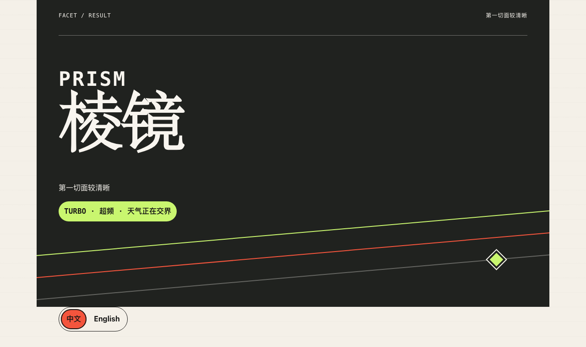

[English README](README.md)

# FACET｜人格切面

FACET 是一个中英双语、本地优先的人格自我观察测试。它用 32 个日常场景拆出 6 条核心倾向和 2 个近期状态信号，不做诊断，也不举办“最稀有人格”颁奖礼。

**在线体验：** [thworry.github.io/facet-personality](https://thworry.github.io/facet-personality/)



## 它会给你什么

FACET 先问你平时怎么做，再用最后 8 题看看最近两周的负荷与恢复。完整结果包括：

- 6 条连续的核心线路：内在坐标、启动节奏、控制偏好、社交充电、边界强度和表达策略；
- 2 个近期信号：负荷水平与恢复弹性；
- 最接近的原型、一个相邻切面，以及 4 种“当前天气”之一；
- 一份能看懂的运行说明、本地保存的最近 3 次结果，以及浏览器内生成的分享卡。

十二原型只是连续维度上的参考坐标，不是等级、稀有度或终身身份。这里没有隐藏款，更没有抽卡保底。

切换语言只会改变展示文案。中文和英文共用题目 ID、计分方向、阈值与原型中心。这能保证产品逻辑一致，但不代表已经建立跨文化心理测量等价性。

## 隐私与使用边界

整套测试都在浏览器内运行。FACET 没有账号、统计脚本、广告追踪，也不会上传逐题答案。未完成进度、语言偏好和最近 3 次结果只保存在本地，直到你主动清除。分享卡由 Canvas 当场绘制并下载。

FACET 只用于娱乐和自我观察。它不是经过同行评议的心理量表，也不适合拿来做心理诊断、招聘筛选、职业决策或关系判决。

## 反馈与隐私

答题过程不会向 GitHub 或维护者发送任何内容。项目没有分析统计、追踪像素、账号系统，也不会远程上传答案。

GitHub Issue 完全自愿，而且内容公开。请用虚构示例描述问题，不要附上自己的答案、结果历史、localStorage 导出、令牌或无关个人信息。疑似安全漏洞请通过 [GitHub 私密安全报告页面](https://github.com/Thworry/facet-personality/security/advisories/new)提交；完整规则见 [SECURITY.md](SECURITY.md)。

## 分数怎么算

每题使用五级刻度。反向题会先反转分值，同一维度的 4 道题再取平均并换算为 0 到 100。维度两端没有高低优劣。

系统会用标准化欧氏距离，把 6 条核心分数与 12 个固定原型中心比较。最近的两个中心分别成为主要原型与相邻切面。结果清晰度、突出线路和近期天气均使用公开、固定的阈值。计分元数据与语言无关，并由 `tests/scoring.test.ts` 和 `tests/result.test.ts` 持续验证。

## 本地开发

需要 Node.js 24 或更高版本，以及 pnpm 11.19.0。

```bash
pnpm install --frozen-lockfile
pnpm dev
pnpm lint
pnpm typecheck
pnpm test
pnpm test:e2e
pnpm build
```

`pnpm dev` 启动本地 Vite 服务。`pnpm build` 会生成自包含的 `dist/index.html`，脚本和样式都内联在同一个文件里。

第一次在新环境运行时，请先执行一次 `pnpm exec playwright install chromium` 安装锁定版本的浏览器，再运行 `pnpm test:e2e`。

## 测试范围

- Vitest 覆盖计分、结果生成、历史迁移、语言目录、页面渲染、Canvas 分享卡和发布包装。
- Playwright 在移动端、桌面端和减少动态效果三种项目中跑完整中英文流程。
- 浏览器检查还包括键盘操作、切换语言不丢状态、本地数据删除、PNG 下载、英文长文案和第三方请求门禁。

浏览器测试默认使用 `4173` 端口。若端口已占用，可以这样切换：

```bash
FACET_E2E_PORT=4183 pnpm test:e2e
```

## 项目结构

```text
src/app/       状态、控制器与各页面渲染器
src/data/      与语言无关的题目和原型定义
src/domain/    计分、结果、存储与 Canvas 分享逻辑
src/i18n/      类型化双语文案与语言选择
src/styles/    视觉变量、布局、组件和响应式规则
tests/         Vitest 单元测试与发布测试
e2e/           本地与线上 Playwright 流程
docs/assets/   浏览器实拍的中英文预览图
```

## 参与贡献

欢迎提交问题、文案修正、无障碍改进和范围清楚的产品优化。发起拉取请求前，请先阅读 [贡献指南](CONTRIBUTING.md)。参与项目即表示你同意遵守 [行为准则](CODE_OF_CONDUCT.md)。

## 许可证

FACET 使用 [MIT License](LICENSE) 开源。
